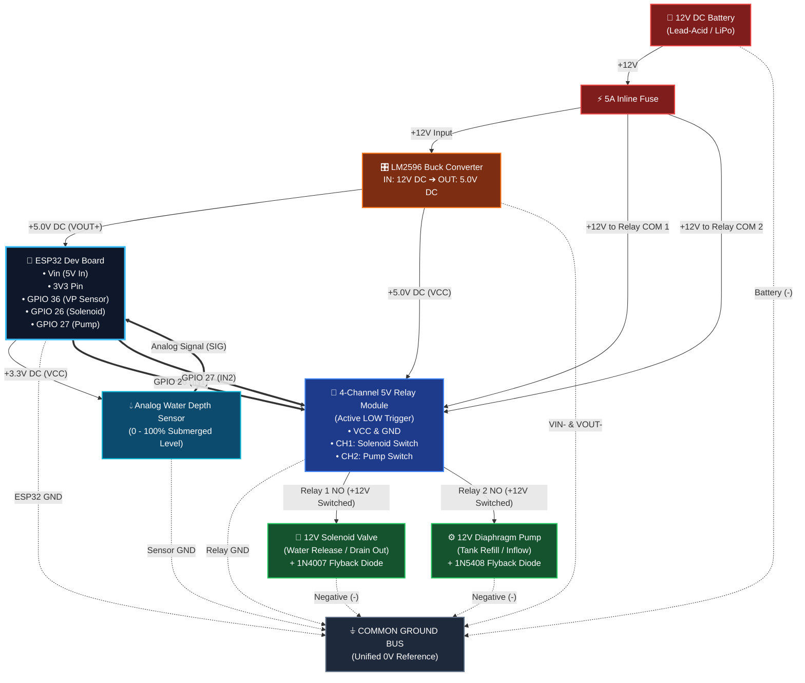

# ESP32 Water Level Monitoring - Hardware & Visual Circuit Schematic Guide

This document provides complete instructions and visual diagrams for wiring the **ESP32**, **12V Battery**, **LM2596 Buck Converter**, **4-Channel 5V Relay Module**, **12V Solenoid Valve**, **12V Diaphragm Pump**, and **Analog Water Level Sensor Module**.

---

## 🎨 Visual Schematic Quick Links

For an ultra-clear, color-coded visual wiring diagram, open the dedicated schematic viewers:

- 🌐 **[Interactive Visual Schematic Viewer (HTML)](file:///c:/Users/Jem/.gemini/antigravity-ide/scratch/esp32-water-level-monitor/docs/circuit_schematic.html)**  
  *(Features clickable component inspection, animated current flow, live rail isolation for 12V / 5V / 3.3V / GND, and zoom/pan controls)*
- 🖼️ **[High-Resolution Vector Schematic (SVG)](file:///c:/Users/Jem/.gemini/antigravity-ide/scratch/esp32-water-level-monitor/docs/circuit_schematic.svg)**  
  *(Clean vector graphics viewable in any browser or image editor)*

---

## 1. Visual Flowchart Schematic (Mermaid)



---

## 2. Voltage Topology & Power Distribution

The system runs off a single **12V DC Battery**:
- **12V High-Power Rail (Red Wire)**: Supplies the 12V Solenoid Valve and 12V Diaphragm Pump through Relay 1 and Relay 2.
- **5V Logic Rail (Orange Wire)**: Stepped down from 12V using the **LM2596 Buck Converter** to power the ESP32 (`Vin` pin) and the Relay Module (`VCC`).
- **3.3V Sensor Rail (Gold Wire)**: Sourced directly from the ESP32 `3V3` pin to power the Analog Water Sensor (prevents exceeding the ESP32 3.3V ADC limit).
- **Common Ground Rail (Black / Slate Wire)**: Bridges all components together to establish a unified 0V DC reference.

```
       +-------------------------------------------------------------+
       |                  12V DC BATTERY / POWER                     |
       +-------+---------------------------------------------+-------+
               | (+12V)                                      | (GND)
               |                                             |
     [ 5A Inline Fuse ]                                      |
               |                                             |
       +-------+-------------------------+                   |
       |                                 |                   |
+------v-------------+         +---------v---------+         |
|   BUCK CONVERTER   |         | 4-CH RELAY MODULE |         |
| (LM2596 Step-Down) |         | (COM 1 & COM 2)   |         |
| OUT: Exactly 5.0V  |         +----+---------+----+         |
+------+--------+----+              | NO 1    | NO 2         |
       | (+5V)  | (GND)             | (+12V)  | (+12V)       |
       |        +-------+           |         |              |
       |                |      +----v----+ +--v-------+      |
+------v--------+       |      | 12V     | | 12V      |      |
| ESP32 Vin Pin |       |      | Solenoid| | Diaphragm|      |
+---------------+       |      | Valve   | | Pump     |      |
                        |      +----+----+ +----+-----+      |
                        |           | (-)       | (-)        |
                        |           |           |            |
             +----------v-----------v-----------v------------v------+
             |                  COMMON GROUND BUS                   |
             +------------------------------------------------------+
```

> [!CAUTION]
> **COMMON GROUND IS MANDATORY**: You MUST connect the GND of the 12V Battery, the GND of the Buck Converter Output, the GND of the ESP32, and the GND of the Relay Module together. Without a common ground reference, analog ADC readings will float and relays will fail to trigger.

---

## 3. Pin Mapping Reference Table

| Component | Component Pin | ESP32 Pin | Wire Color Code | Notes / Code Constant |
| :--- | :--- | :--- | :--- | :--- |
| **Buck Converter** | VOUT+ | **Vin (5V)** | 🟠 Orange (+5V) | Adjust to exactly 5.0V DC before connecting |
| | VOUT- | **GND** | ⚫ Black (GND) | Connects to common ground bus |
| **Water Sensor** | VCC (+) | **3V3 Pin** | 🟡 Gold (+3.3V) | **Do not connect to 5V** (protects ADC) |
| | GND (-) | **GND Pin** | ⚫ Black (GND) | Sensor ground |
| | SIG / OUT | **GPIO 36 (VP)** | 🔵 Cyan (Signal) | `PIN_WATER_SENSOR` (ADC1_CH0, 0-4095) |
| **4-Ch Relay Board** | VCC | **5V Rail** | 🟠 Orange (+5V) | Sourced from Buck Converter VOUT+ |
| | GND | **GND Rail** | ⚫ Black (GND) | Common ground |
| | IN1 | **GPIO 26** | 🟢 Green (Signal) | `PIN_RELAY_SOLENOID` (Active LOW) |
| | IN2 | **GPIO 27** | 🟣 Purple (Signal) | `PIN_RELAY_PUMP` (Active LOW) |
| | IN3 | **GPIO 14** | 🔴 Pink (Signal) | `PIN_RELAY_AUX1` (Auxiliary / Alarm) |
| | IN4 | **GPIO 12** | 🔴 Pink (Signal) | `PIN_RELAY_AUX2` (Auxiliary Output) |
| **Onboard LED** | Built-in | **GPIO 2** | — | Status / Bluetooth heartbeat indicator |

---

## 4. Actuator Wiring & Inductive Flyback Protection

### A. 12V Solenoid Valve (Channel 1 - Water Release & Drain Out)
- **12V Battery (+)** ➔ Relay 1 **COM** terminal
- Relay 1 **NO (Normally Open)** ➔ 12V Solenoid Valve **(+) Terminal**
- 12V Solenoid Valve **(-) Terminal** ➔ **Common Ground Bus**
- Control wire: ESP32 **GPIO 26** ➔ Relay Board **IN1**

### B. 12V Diaphragm Pump (Channel 2 - Tank Refill / Inflow)
- **12V Battery (+)** ➔ Relay 2 **COM** terminal
- Relay 2 **NO (Normally Open)** ➔ 12V Diaphragm Pump **(+) Terminal**
- 12V Diaphragm Pump **(-) Terminal** ➔ **Common Ground Bus**
- Control wire: ESP32 **GPIO 27** ➔ Relay Board **IN2**

---

## 5. Crucial Inductive Protection (Flyback Diodes)

> [!WARNING]
> Both the **Solenoid Valve** and the **Diaphragm Pump** are heavy inductive coils. When the relay opens and cuts power, the collapsing magnetic field creates a reverse voltage spike exceeding **+100V DC**. This back-EMF will travel across your power wires and instantly freeze or permanently destroy your ESP32.

### Diode Installation Guide
Install a **1N4007** (for solenoid) and **1N5408** (for pump) diode directly across each component's terminals:

```
               (+12V from Relay NO)
                        |
                        +------------+
                        |            |
                 [=== CATHODE ===]   |
                 [  (Silver Band)|   |
                 [     1N4007    |   |
                 [     DIODE     |   |
                 [    ANODE      |   |
                        |            |
                        +------------+
                        |      [ INDUCTIVE LOAD ]
                        |      (Solenoid / Pump)
                        |            |
                        +------------+
                        |
                  (GND / Ground)
```

- **Cathode (Striped Side)**: Must connect to the **Positive (+) terminal** of the Solenoid / Pump.
- **Anode (Unstriped Side)**: Must connect to the **Negative (- / Ground) terminal** of the Solenoid / Pump.

---

## 6. Pre-Power Checklist

1. [ ] **Calibrate Buck Converter First**: Disconnect the ESP32. Turn on the 12V battery and measure the Buck Converter output with a multimeter. Adjust the screw trimpot until it reads **5.00V ± 0.05V**.
2. [ ] **Verify Common Ground**: Verify with a continuity buzzer that ESP32 GND, Buck OUT-, Relay GND, Battery (-), and Solenoid/Pump (-) are all securely tied together.
3. [ ] **Check Flyback Diode Polarity**: Confirm the silver cathode band is facing the (+) side. If connected backward, the diode will short-circuit your 12V rail!
4. [ ] **Sensor Voltage**: Confirm the water depth sensor is powered from **3.3V** (not 5V), keeping the ADC signal within safe limits.
